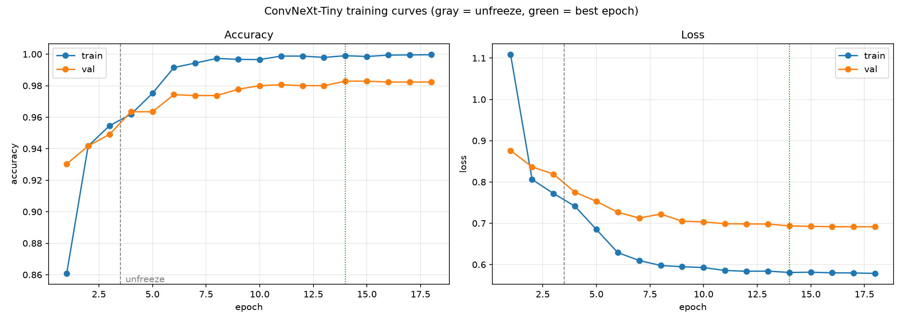
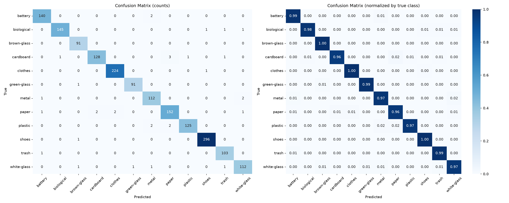
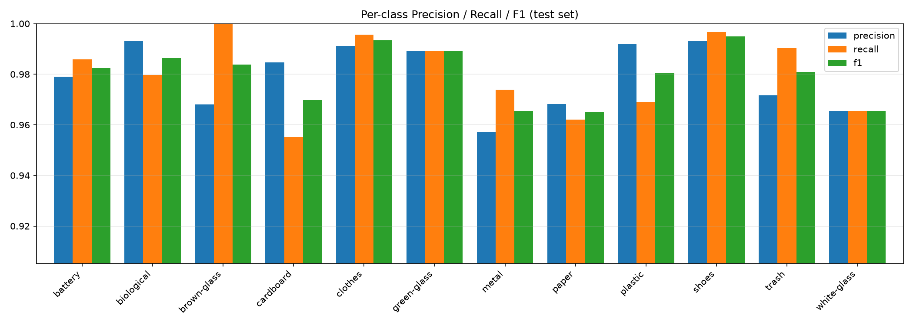
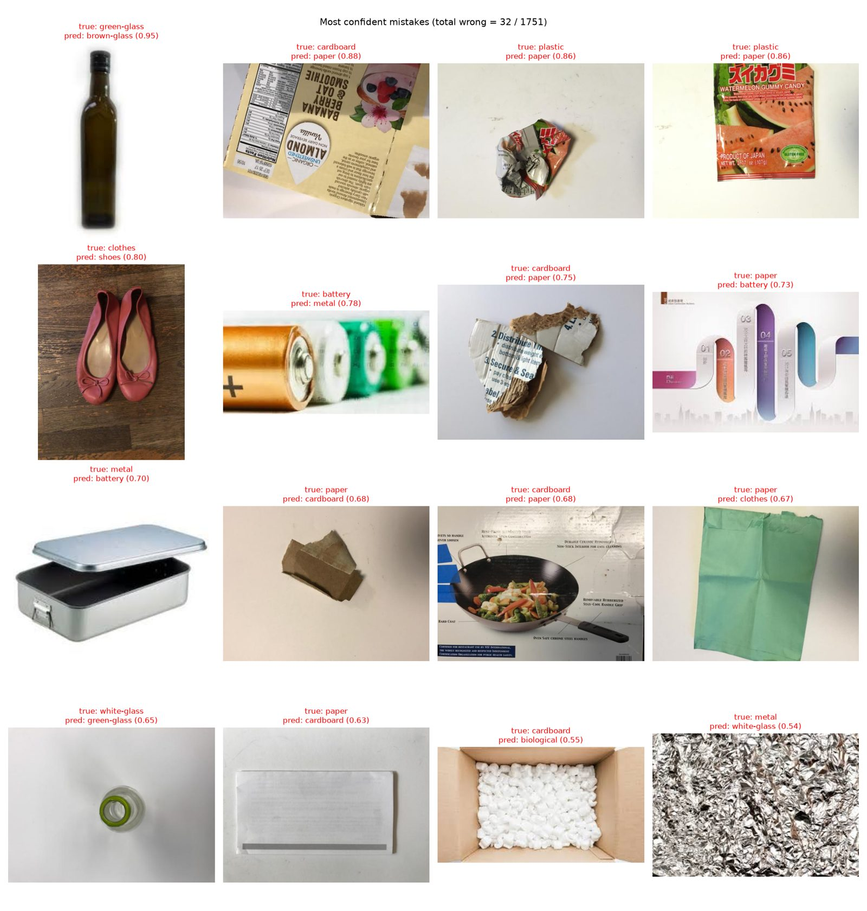
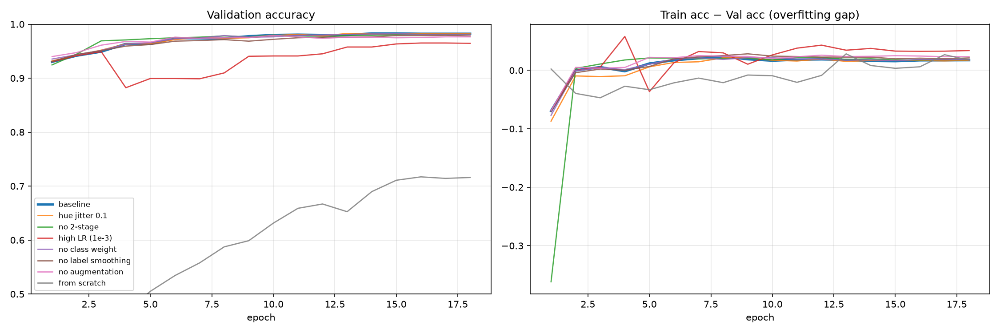

Deep Learning Project · Image Classification

# จำแนกประเภทขยะ 12 คลาสด้วย ConvNeXt-Tiny

> หมายเหตุ: แผนภาพ SVG ในต้นฉบับ (โครงสร้างโมเดล, ConvNeXt block, กราฟ learning rate) แสดงเป็นข้อความอธิบายแทน ส่วนกราฟและรูปอื่นอยู่ในโฟลเดอร์ `images/`

Transfer learning จาก ImageNet บน dataset garbage\_split วัดผลบน test set ที่โมเดลไม่เคยเห็นระหว่างเทรน

ไม่คุ้นกับคำศัพท์ เช่น learning rate, epoch, precision ดูคำอธิบายได้ที่ ภาคผนวก: อธิบายคำศัพท์และแนวคิด (ท้ายเอกสาร)

- Test accuracy: **98.17%**
- Macro F1-score: **0.9798**
- Top-3 accuracy: **99.71%**
- รูปที่ทายผิด: **32 / 1,751**

## 01. โมเดล

ใช้ **ConvNeXt-Tiny** ซึ่งเป็น CNN ที่ปรับสถาปัตยกรรมตามแนวคิดของ Vision Transformer (patchify stem, depthwise conv 7×7, LayerNorm, GELU) โหลด weights ที่เทรนบน ImageNet-1K มาแล้ว และเปลี่ยนชั้นสุดท้ายให้ออก 12 คลาส

|  |  |
| --- | --- |
| สถาปัตยกรรม | ConvNeXt-Tiny (torchvision) · 4 stages, depth [3, 3, 9, 3], channels [96, 192, 384, 768] |
| Pretrained weights | IMAGENET1K\_V1 |
| จำนวนพารามิเตอร์ | 27.83 M |
| Classifier head | LayerNorm → Flatten → Linear 768 → **12** (เดิม 1000) |
| Input | 3 × 224 × 224 |

[แผนภาพ SVG: เปรียบเทียบตัวหารของ Precision กับ Recall จาก confusion matrix]

โครงสร้าง ConvNeXt-Tiny ตัวเลขใต้กล่องคือขนาดข้อมูล (สูง × กว้าง × channel) หลังผ่านแต่ละส่วน ยิ่งลึก ภาพยิ่งเล็กลงแต่มี channel มากขึ้น คือข้อมูลเปลี่ยนจาก "พิกเซล" เป็น "feature ที่มีความหมาย" สุดท้ายได้เวกเตอร์ 768 ตัวเลขส่งให้หัวแปลงเป็นคะแนน 12 คลาส

[แผนภาพ SVG: เปรียบเทียบตัวหารของ Precision กับ Recall จาก confusion matrix]

### ข้างในหนึ่ง ConvNeXt block

ทั้งโมเดลมี block แบบนี้ 18 ตัว (3 + 3 + 9 + 3) แต่ละตัวทำงานตามลำดับ:

- **Depthwise Conv 7×7** มองพื้นที่รอบพิกเซลกว้าง 7×7 แยกทีละ channel หาลวดลายเชิงพื้นที่ เช่น ขอบ รอยยับของกระดาษ
- **LayerNorm** ปรับสเกลค่าให้อยู่ในช่วงเสถียร ช่วยให้เทรนลื่น
- **Conv 1×1 ขยายเป็น 4 เท่า → GELU → บีบกลับ** ผสมข้อมูลข้าม channel ที่ตำแหน่งเดียวกัน เช่น รวม "สีน้ำตาล" กับ "ผิวมันวาว" เป็น "ขวดแก้วสีน้ำตาล" การขยายก่อนบีบกลับ (inverted bottleneck) ให้พื้นที่คำนวณมากขึ้น
- **Residual (+)** บวก input เดิมกลับเข้าไป block จึงเรียนแค่ "ส่วนที่ต้องแก้" และ gradient ไหลย้อนผ่านทางลัดได้ ทำให้เทรนโมเดลลึกได้

## 02. Dataset

รูปขยะ 11,669 รูป 12 คลาส แบ่งเป็น train / val / test ไว้แล้วในอัตราส่วนประมาณ 70 / 15 / 15 จำนวนรูปต่อคลาสไม่เท่ากัน โดย shoes มากกว่า brown-glass ประมาณ 3.3 เท่า ตรวจด้วย MD5 แล้วไม่พบรูปซ้ำข้าม split

| คลาส | train | val | test |
| --- | --- | --- | --- |
| battery | 661 | 142 | 142 |
| biological | 689 | 148 | 148 |
| brown-glass | 425 | 91 | 91 |
| cardboard | 624 | 133 | 134 |
| clothes | 1,050 | 225 | 225 |
| green-glass | 430 | 92 | 92 |
| metal | 538 | 115 | 115 |
| paper | 735 | 157 | 158 |
| plastic | 604 | 130 | 129 |
| shoes | 1,384 | 296 | 297 |
| trash | 488 | 105 | 104 |
| white-glass | 540 | 116 | 116 |
| รวม | 8,168 | 1,750 | 1,751 |

|  |  |
| --- | --- |
| ขนาดรูป | 224 × 224 |
| Batch size | 64 |
| Normalize | ค่า mean / std ของ ImageNet [0.485, 0.456, 0.406] / [0.229, 0.224, 0.225] |
| Augmentation (train) | RandomResizedCrop (scale 0.6–1.0), HorizontalFlip, Rotation ±15°, ColorJitter (brightness 0.2, contrast 0.2, saturation 0.1) |
| ไม่ปรับ hue | brown-glass, green-glass, white-glass แยกกันด้วยสี ถ้าสุ่มเปลี่ยน hue โมเดลจะแยกสามคลาสนี้ไม่ได้ |
| Val / Test | Resize 256 → CenterCrop 224 ไม่มี augmentation |

## 03. การตั้งค่าการเทรน

เทรน 2 ขั้น ขั้นแรกล็อก backbone ไว้เพื่อให้ classifier ใหม่ปรับตัวก่อน แล้วจึงปลดล็อกทั้งโมเดลเพื่อ fine-tune ด้วย learning rate ต่ำ ป้องกันไม่ให้ weights จาก ImageNet ถูกทำลายในช่วงแรก

### Stage 1 · เทรนเฉพาะหัว

- Epochs: 3
- ส่วนที่เทรน: classifier (freeze backbone)
- Optimizer: AdamW
- Learning rate: 1e-3 คงที่
- Weight decay: 0.05

### Stage 2 · Fine-tune ทั้งโมเดล

- Epochs: 15
- ส่วนที่เทรน: ทุกชั้น
- Optimizer: AdamW
- Learning rate: backbone 1e-4 · head 5e-4
- Scheduler: OneCycleLR (cosine, warmup 10%)
- Weight decay: 0.05

[แผนภาพ SVG: เปรียบเทียบตัวหารของ Precision กับ Recall จาก confusion matrix]

Learning rate ตลอดการเทรน จำลองจาก OneCycleLR ด้วยค่าเดียวกับตอนเทรนจริง (127 step ต่อ epoch) ช่วง epoch 0–3 backbone ถูก freeze จึงไม่ถูกปรับเลย และเทรนเฉพาะหัวด้วย LR คงที่ 1e-3 พอ unfreeze ทั้งสองส่วนเริ่มจาก LR ต่ำมาก ไต่ขึ้นถึงจุดสูงสุดในช่วง warmup แล้วค่อยๆ ลดแบบ cosine จนเกือบ 0 ตอนจบ

|  |  |
| --- | --- |
| Loss | CrossEntropyLoss + class weight N / (12 × nc) + label smoothing 0.1 |
| Mixed precision | bfloat16 (torch.autocast), channels\_last |
| เลือกโมเดล | เก็บ checkpoint ที่ val accuracy สูงสุด ได้ epoch 14 (val acc 0.9829) |
| Seed | 42 |
| Hardware | NVIDIA RTX 5080 16 GB · PyTorch 2.14.1 + CUDA 13.0 · ประมาณ 9 วินาทีต่อ epoch (รวมประมาณ 3 นาที) |

## 04. เหตุผลในการเลือกโมเดลและการตั้งค่า

ค่าส่วนใหญ่เป็นค่ามาตรฐานของการ fine-tune ConvNeXt จากงานวิจัยต้นฉบับและแนวปฏิบัติของ transfer learning เหตุผลด้านล่างเป็นเหตุผลเชิงทฤษฎี ส่วนผลการทดลองที่ยืนยันหรือแย้งเหตุผลเหล่านี้อยู่ในหัวข้อ 07

### ทำไมใช้ Transfer Learning

train set มีแค่ประมาณ 8,000 รูป ถ้าเทรน CNN จากศูนย์ โมเดลต้องเรียนรู้ feature พื้นฐานอย่างขอบ สี และ texture เอง ซึ่งปกติต้องใช้ข้อมูลหลักแสนถึงล้านรูป โมเดลที่ pretrained บน ImageNet (1.28 ล้านรูป) เรียนรู้ feature เหล่านี้มาแล้ว เราแค่สอนให้นำ feature นั้นมาแยกขยะ 12 ประเภท

### ทำไมเลือก ConvNeXt-Tiny

| เทียบกับ | เหตุผล |
| --- | --- |
| ResNet50 | ConvNeXt คือ CNN ที่ปรับดีไซน์ตาม Vision Transformer (kernel 7×7, LayerNorm, GELU, inverted bottleneck) ได้ ImageNet top-1 ประมาณ 82.1% เทียบกับ ResNet50 ประมาณ 76–80% ในขนาดใกล้กัน |
| ViT / Swin | ViT ขาด inductive bias ของ convolution (มองพื้นที่ใกล้เคียงก่อน และหาวัตถุเจอไม่ว่าจะอยู่ตรงไหนในภาพ) จึงต้องการข้อมูลมากและปรับค่ายากกว่า ConvNeXt ยังเป็น convolution จึงเทรนกับข้อมูลน้อยได้เสถียรกว่า |
| ConvNeXt-Small / Base | รุ่น Tiny มี 28M พารามิเตอร์ ซึ่งพอดีกับข้อมูล 8,000 รูป รุ่นใหญ่กว่าเสี่ยง overfit มากขึ้นและเทรนช้ากว่า โดยไม่น่าได้ accuracy เพิ่มขึ้นมากบน dataset นี้ |

### เหตุผลของแต่ละการตั้งค่า

| การตั้งค่า | เหตุผล |
| --- | --- |
| 224 × 224 | ขนาดเดียวกับตอน pretrain บน ImageNet ทำให้ feature ที่เรียนมาใช้ได้ตรงที่สุด |
| Normalize แบบ ImageNet | weights ถูกเทรนกับ input ที่ normalize ด้วยค่านี้ ถ้าใช้ค่าอื่น การกระจายของ input จะไม่ตรงกับที่โมเดลคาดไว้ |
| Batch 64 | ใส่ใน GPU 16 GB ได้สบาย และใหญ่พอให้ gradient เสถียร |
| RandomResizedCrop 0.6–1.0 | จำลองการถ่ายใกล้ไกลและตำแหน่งวัตถุที่ต่างกัน ไม่ crop เล็กกว่า 60% เพราะวัตถุอาจหลุดออกจากภาพ |
| Flip แนวนอน, หมุน ±15° | ขยะที่กลับซ้ายขวาหรือเอียงเล็กน้อยยังเป็นประเภทเดิม ไม่ flip แนวตั้งเพราะรองเท้าหรือขวดคว่ำดูไม่เป็นธรรมชาติ |
| ColorJitter ไม่ปรับ hue | brightness, contrast และ saturation ช่วยรับมือกับแสงที่ต่างกัน แต่ brown-glass, green-glass และ white-glass ต่างกันแค่สี ถ้าสุ่มเปลี่ยน hue ขวดสีน้ำตาลอาจกลายเป็นสีเขียว เท่ากับสอน label ผิด |
| Val / Test ไม่ augment | ต้องวัดผลกับรูปจริงที่ไม่ถูกดัดแปลง ผลจึงคงที่และเทียบกันได้ |
| Class weight | shoes มี 1,384 รูป แต่ brown-glass มี 425 ถ้าไม่ถ่วงน้ำหนัก โมเดลจะเอนไปทายคลาสที่มีรูปเยอะ |
| Label smoothing 0.1 | ตั้งเป้าให้โมเดลมั่นใจประมาณ 90% แทน 100% ลด overconfidence และ overfit ข้อแลกเปลี่ยนคือ train loss ไม่ลงถึง 0 |
| เทรน 2 ขั้น | หัว classifier ใหม่เริ่มจากค่าสุ่ม gradient ช่วงแรกจึงใหญ่และไม่มีทิศทาง ถ้าปล่อยเข้า backbone ทันทีจะทำลาย feature จาก ImageNet (catastrophic forgetting) จึงเทรนหัวให้เข้าที่ก่อน 3 epoch |
| LR backbone 1e-4, head 5e-4 | backbone ดีอยู่แล้ว จึงปรับทีละน้อยด้วย lr ต่ำ ส่วนหัวเป็นของใหม่จึงใช้ lr สูงกว่า (discriminative learning rate) |
| OneCycleLR + warmup 10% | ค่อยๆ เพิ่ม lr ช่วงแรกเพื่อไม่ให้กระชากตอนเพิ่ง unfreeze จากนั้นลดแบบ cosine จนเกือบ 0 ให้โมเดลค่อยๆ เข้าใกล้จุดที่ดีที่สุด |
| 15 epoch (stage 2) | จากกราฟ val acc นิ่งตั้งแต่ประมาณ epoch 11–14 เทรนนานกว่านี้น่าจะไม่ได้อะไรเพิ่ม |
| AdamW + weight decay 0.05 | เป็นค่าที่ทีมผู้พัฒนา ConvNeXt ใช้ในงานวิจัยต้นฉบับ AdamW แยก weight decay ออกจาก gradient ทำให้ regularization ทำงานถูกต้องกว่า Adam ปกติ |
| เลือก checkpoint จาก val | เป็น early stopping แบบหนึ่ง ใช้ val ในการเลือกเพื่อให้ test เป็นตัววัดผลที่ไม่ลำเอียง |
| bf16, channels\_last | เพื่อความเร็วบน GPU เท่านั้น ไม่มีผลต่อความแม่นยำอย่างมีนัยสำคัญ |

## 05. ผลการเทรน

เส้นประสีเทาคือจุดที่ปลด freeze backbone (หลัง epoch 3) เส้นประสีเขียวคือ epoch ที่ดีที่สุด (14) Train loss หยุดที่ประมาณ 0.58 แทนที่จะลงถึง 0 เพราะ label smoothing 0.1 ทำให้ loss มีค่าต่ำสุดที่ไม่ใช่ศูนย์

| Epoch | Stage | Train loss | Train acc | Val loss | Val acc | LR |
| --- | --- | --- | --- | --- | --- | --- |
| 1 | head | 1.1082 | 0.8609 | 0.8762 | 0.9303 | 1.00e-03 |
| 2 | head | 0.8062 | 0.9417 | 0.8367 | 0.9417 | 1.00e-03 |
| 3 | head | 0.7721 | 0.9546 | 0.8190 | 0.9491 | 1.00e-03 |
| 4 | full | 0.7413 | 0.9619 | 0.7753 | 0.9634 | 7.65e-05 |
| 5 | full | 0.6850 | 0.9751 | 0.7531 | 0.9634 | 9.97e-05 |
| 6 | full | 0.6289 | 0.9915 | 0.7266 | 0.9743 | 9.70e-05 |
| 7 | full | 0.6098 | 0.9943 | 0.7126 | 0.9737 | 9.17e-05 |
| 8 | full | 0.5978 | 0.9973 | 0.7224 | 0.9737 | 8.42e-05 |
| 9 | full | 0.5948 | 0.9967 | 0.7050 | 0.9777 | 7.49e-05 |
| 10 | full | 0.5928 | 0.9966 | 0.7033 | 0.9800 | 6.43e-05 |
| 11 | full | 0.5856 | 0.9988 | 0.6988 | 0.9806 | 5.28e-05 |
| 12 | full | 0.5838 | 0.9988 | 0.6983 | 0.9800 | 4.12e-05 |
| 13 | full | 0.5841 | 0.9979 | 0.6981 | 0.9800 | 3.01e-05 |
| 14 | full | 0.5809 | 0.9990 | 0.6937 | 0.9829 | 2.01e-05 |
| 15 | full | 0.5815 | 0.9985 | 0.6925 | 0.9829 | 1.16e-05 |
| 16 | full | 0.5801 | 0.9994 | 0.6917 | 0.9823 | 5.28e-06 |
| 17 | full | 0.5796 | 0.9995 | 0.6915 | 0.9823 | 1.33e-06 |
| 18 | full | 0.5786 | 0.9996 | 0.6916 | 0.9823 | 4.84e-10 |

## 06. ผลบน Test set

ใช้ checkpoint จาก epoch 14 ทดสอบกับ test set 1,751 รูป

|  | Accuracy | Precision | Recall | F1-score |
| --- | --- | --- | --- | --- |
| Macro avg | 0.9817 | 0.9794 | 0.9803 | 0.9798 |
| Weighted avg | 0.9817 | 0.9818 | 0.9817 | 0.9817 |

### ผลรายคลาส

| คลาส | Precision | Recall | F1-score | Support | หมายเหตุ |
| --- | --- | --- | --- | --- | --- |
| battery | 0.9790 | 0.9859 | 0.9825 | 142 |  |
| biological | 0.9932 | 0.9797 | 0.9864 | 148 |  |
| brown-glass | 0.9681 | 1.0000 | 0.9838 | 91 |  |
| cardboard | 0.9846 | 0.9552 | 0.9697 | 134 |  |
| clothes | 0.9912 | 0.9956 | 0.9933 | 225 | สูงสุด |
| green-glass | 0.9891 | 0.9891 | 0.9891 | 92 |  |
| metal | 0.9573 | 0.9739 | 0.9655 | 115 | ต่ำสุด |
| paper | 0.9682 | 0.9620 | 0.9651 | 158 | ต่ำสุด |
| plastic | 0.9921 | 0.9690 | 0.9804 | 129 |  |
| shoes | 0.9933 | 0.9966 | 0.9950 | 297 | สูงสุด |
| trash | 0.9717 | 0.9904 | 0.9810 | 104 |  |
| white-glass | 0.9655 | 0.9655 | 0.9655 | 116 | ต่ำสุด |

Confusion matrix ซ้ายเป็นจำนวนรูป ขวาเป็นสัดส่วนเทียบกับคลาสจริง (ค่าบนเส้นทแยงคือ recall ของแต่ละคลาส)

### คู่คลาสที่สับสนบ่อยที่สุด

| คลาสจริง | ทายเป็น | จำนวน |
| --- | --- | --- |
| cardboard | paper | 3 |
| plastic | metal | 2 |
| plastic | paper | 2 |
| paper | clothes | 2 |
| paper | cardboard | 2 |
| battery | metal | 2 |
| metal | white-glass | 2 |

Precision / Recall / F1 รายคลาส ทุกคลาสสูงกว่า 0.95

16 รูปที่โมเดลทายผิดโดยมั่นใจที่สุด หลายรูปมีวัตถุหลายชนิดในภาพ หรือวัสดุดูคล้ายกันจริง เช่น กล่องกระดาษบางกับกระดาษ

## 07. ทดลองเปลี่ยนการตั้งค่า (Ablation study)

ใช้ ConvNeXt-Tiny ตัวเดิม แล้วเปลี่ยนการตั้งค่า**ทีละอย่าง** เทียบกับ baseline ทุกการทดลองเทรน 18 epoch เท่ากัน เลือก checkpoint จาก val accuracy สูงสุด แล้ววัดบน test set เดียวกัน (1,751 รูป)

เพื่อให้รู้ว่าความต่างเท่าไรถือว่ามีความหมาย จึงรัน baseline 3 seed ได้ test accuracy **98.32% ± 0.17%** (ต่ำสุด 98.17%, สูงสุด 98.52%) แปลว่าแค่เปลี่ยน seed ผลก็แกว่งได้ประมาณ 0.3% หรือราว 6 รูป การทดลองอื่นรันแค่ seed เดียว ความต่างที่เล็กกว่าระดับนี้จึงสรุปไม่ได้ว่าดีกว่าหรือแย่กว่า

| การทดลอง | สิ่งที่เปลี่ยน | Val acc | Test acc | Δ เทียบ baseline | Macro F1 | F1 กลุ่มแก้ว | F1 คลาสต่ำสุด | ผล |
| --- | --- | --- | --- | --- | --- | --- | --- | --- |
| baseline | การตั้งค่าที่ใช้ (seed 42) | 98.29% | 98.17% | -0.15 | 0.9798 | 0.9795 | 0.9651 |  |
| baseline (seed 1) | baseline เปลี่ยน seed | 98.29% | 98.29% | -0.04 | 0.9814 | 0.9814 | 0.9607 |  |
| baseline (seed 2) | baseline เปลี่ยน seed | 98.17% | 98.52% | +0.19 | 0.9842 | 0.9855 | 0.9651 |  |
| hue jitter 0.1 | เพิ่ม ColorJitter hue=0.1 | 98.29% | 97.89% | -0.44 | 0.9762 | 0.9763 | 0.9610 | แย่ลงเล็กน้อย |
| no 2-stage | fine-tune ทั้งโมเดลตั้งแต่ epoch แรก | 98.11% | 97.89% | -0.44 | 0.9777 | 0.9769 | 0.9649 | แย่ลงเล็กน้อย |
| high LR (1e-3) | lr backbone 1e-3 (สูงกว่า 10 เท่า) | 96.51% | 95.95% | -2.38 | 0.9559 | 0.9521 | 0.9062 | แย่ลงชัดเจน |
| no class weight | ไม่ถ่วงน้ำหนักคลาส | 98.23% | 98.17% | -0.15 | 0.9799 | 0.9794 | 0.9565 | ไม่ต่าง |
| no label smoothing | label smoothing = 0 | 97.94% | 98.12% | -0.21 | 0.9794 | 0.9778 | 0.9483 | ไม่ต่าง |
| no augmentation | ไม่ augment รูป train | 97.94% | 98.17% | -0.15 | 0.9800 | 0.9795 | 0.9565 | ไม่ต่าง |
| from scratch | ไม่ใช้ pretrained weights | 71.71% | 68.93% | -29.39 | 0.6872 | 0.7524 | 0.4935 | แย่ลงมาก |

Δ เทียบกับค่าเฉลี่ยของ baseline 3 seed · F1 กลุ่มแก้ว = ค่าเฉลี่ย F1 ของ brown-glass, green-glass และ white-glass · F1 คลาสต่ำสุด = F1 ของคลาสที่ทำได้แย่ที่สุดในการทดลองนั้น

ซ้าย: val accuracy ของแต่ละการทดลอง เส้น high LR ร่วงลงทันทีที่ unfreeze (epoch 4) และฟื้นได้ไม่เต็ม ส่วน from scratch (สีเทา) ขึ้นช้ามากและหยุดที่ประมาณ 72% ขวา: ช่องว่าง train − val (ยิ่งสูงยิ่ง overfit)

### ผลเทียบกับเหตุผลในหัวข้อ 04

| เหตุผลที่ตั้งไว้ | ผลการทดลอง |
| --- | --- |
| ใช้ pretrained weights | ยืนยันชัดเจน เทรนจากศูนย์ได้แค่ 68.93% ต่ำกว่า baseline เกือบ 30 จุด ในเวลาเทรนเท่ากัน ข้อมูล 8,000 รูปไม่พอให้เรียน feature เอง |
| LR ต่ำตอน fine-tune | ยืนยันชัดเจน ใช้ lr 1e-3 กับ backbone แล้ว val acc ร่วงจาก 95% เหลือ 88% ทันทีที่ unfreeze แสดงว่า feature จาก ImageNet ถูกทำลาย สุดท้ายได้ test 95.95% ต่ำกว่า baseline 2.4 จุด |
| ไม่ปรับ hue | สอดคล้อง แต่ผลเล็ก เปิด hue jitter แล้ว test acc ต่ำกว่าทุก seed ของ baseline และ F1 กลุ่มแก้วลดลงเป็น 0.976 ซึ่งตรงกับเหตุผล แต่ต่างกันแค่ประมาณ 5 รูป ถ้าจะยืนยันต้องรันหลาย seed |
| เทรน 2 ขั้น | สอดคล้อง แต่ผลเล็ก fine-tune ทั้งโมเดลตั้งแต่แรกได้ test ต่ำกว่า 0.4 จุด ผลเสียไม่มากเพราะ lr backbone ต่ำ (1e-4) และมี warmup ช่วยกันกระชากไว้แล้ว |
| Label smoothing | ไม่ต่างชัดเจน accuracy รวมแทบเท่าเดิม แต่ F1 ของคลาสที่แย่ที่สุดลดลงเหลือ 0.948 (baseline 0.961–0.965) อาจช่วยคลาสที่ยากอยู่บ้าง |
| Class weight | ไม่ต่างชัดเจน accuracy เท่าเดิม เพราะคลาสที่เล็กที่สุดยังมีมากกว่า 400 รูป ความไม่สมดุลจึงไม่รุนแรงพอจะเห็นผล F1 คลาสต่ำสุดลดลงเล็กน้อย (0.957) |
| Augmentation | ไม่ต่างชัดเจน test acc เท่าเดิม แต่ train acc ขึ้นถึง 100% และ val acc ดีที่สุดตั้งแต่ epoch 10 ซึ่งเป็นสัญญาณว่าโมเดลจำข้อมูล train เร็วกว่า ถ้าเทรนนานขึ้นหรือข้อมูลน้อยกว่านี้น่าจะเห็นความต่าง |

**ข้อสรุป:** ไม่มีการตั้งค่าไหนที่ทำได้ดีกว่า baseline จึงใช้การตั้งค่าเดิมต่อ การตั้งค่าที่มีผลมากที่สุดคือการใช้ pretrained weights และการใช้ learning rate ต่ำตอน fine-tune ส่วน hue jitter และการเทรน 2 ขั้นให้ผลไปในทิศทางเดียวกับเหตุผลแต่เล็ก class weight, label smoothing และ augmentation ไม่ทำให้ accuracy รวมต่างจากความแกว่งของ seed บน dataset นี้

## 08. สรุปและข้อสังเกต

- ConvNeXt-Tiny ได้ **test accuracy 98.17%** และ macro F1 0.9798 เทรนเพียง 18 epoch ประมาณ 3 นาที แสดงให้เห็นว่า transfer learning จาก ImageNet ได้ผลดีมากกับข้อมูลขนาดนี้
- คลาสที่ทำได้ดีที่สุดคือ shoes (F1 0.995) และ clothes (0.993) ซึ่งรูปทรงชัดเจน ส่วน brown-glass ได้ recall 100%
- คลาสที่อ่อนที่สุดคือ paper, metal, white-glass (F1 ประมาณ 0.965) และ cardboard (0.970) ความผิดพลาดส่วนใหญ่เกิดระหว่างวัสดุที่หน้าตาคล้ายกัน เช่น cardboard กับ paper และ plastic กับ metal
- Train acc 99.9% เทียบกับ val 98.3% มี overfit เล็กน้อย แต่ val loss ยังลดลงจนจบ ไม่เด้งกลับขึ้น
- Val accuracy (98.29%) กับ test accuracy (98.17%) ใกล้กันมาก แสดงว่าการเลือก checkpoint จาก val ไม่ได้ทำให้ผลเอนเอียง
- รัน baseline 3 seed ได้ test accuracy 98.32% ± 0.17% ผลจึงไม่ได้มาจากความบังเอิญของ seed เดียว และรัน seed 42 ซ้ำได้ 98.17% ตรงกับครั้งแรกทุกหลัก
- Ablation ยืนยันว่า pretrained weights (+29 จุดเทียบกับเทรนจากศูนย์) และ learning rate ต่ำตอน fine-tune (+2.4 จุด) สำคัญที่สุด ไม่มีการตั้งค่าทางเลือกไหนที่ดีกว่า baseline
- ค่า hyperparameter เริ่มจากค่ามาตรฐานของการ fine-tune ConvNeXt แล้วตรวจสอบด้วย ablation แบบเปลี่ยนทีละอย่าง ยังไม่ได้ทำ hyperparameter search แบบเต็ม

## ภาคผนวก: อธิบายคำศัพท์และแนวคิด

อธิบายคำศัพท์ที่ใช้ในรายงานนี้แบบเข้าใจง่าย พร้อมตัวอย่างจากโปรเจกต์นี้ จัดกลุ่มตามขั้นตอนการทำงาน

### พื้นฐานของโมเดล

- Deep Learning: การเรียนรู้ของเครื่องที่ใช้ neural network หลายชั้นซ้อนกัน แต่ละชั้นแปลงข้อมูลให้เป็นตัวแทนที่มีความหมายมากขึ้นเรื่อยๆ เช่น ชั้นแรกเห็นขอบและสี ชั้นกลางเห็นลวดลายและรูปทรง ชั้นท้ายเห็นทั้งวัตถุ
- CNN (Convolutional Neural Network): neural network สำหรับรูปภาพ ใช้ตัวกรองขนาดเล็ก (kernel) เลื่อนไปทั่วภาพเพื่อหาลวดลาย ตัวกรองเดียวกันใช้ได้ทุกตำแหน่ง จึงหาวัตถุเจอไม่ว่าจะอยู่ตรงไหนในภาพ และใช้พารามิเตอร์น้อยกว่าการเชื่อมทุกพิกเซลเข้าด้วยกัน
- พารามิเตอร์ (Parameters / Weights): ตัวเลขภายในโมเดลที่ถูกปรับระหว่างเทรน ConvNeXt-Tiny มี 27.83 ล้านตัว ต่างจาก hyperparameter ซึ่งเป็นค่าที่เราตั้งเองก่อนเทรน เช่น learning rate, batch size, จำนวน epoch
- ConvNeXt: CNN ที่ Meta AI ออกแบบในปี 2022 โดยนำ ResNet มาปรับทีละส่วนตามแนวคิดของ Vision Transformer ได้แก่ kernel ใหญ่ขึ้นเป็น 7×7, ใช้ depthwise convolution (กรองแยกทีละ channel ประหยัดการคำนวณ), LayerNorm (ปรับสเกลค่าในแต่ละชั้นให้เสถียร) และ GELU (activation function ที่โค้งนุ่มกว่า ReLU) ผลคือ CNN ที่แม่นยำเทียบเท่า Transformer แต่เทรนง่ายกว่า
- Backbone และ Classifier head: Backbone คือส่วนใหญ่ของโมเดลที่ทำหน้าที่สกัด feature จากภาพ ได้ออกมาเป็นเวกเตอร์ 768 ตัวเลขต่อรูป Classifier head คือชั้นสุดท้ายที่แปลงเวกเตอร์นั้นเป็นคะแนนของแต่ละคลาส ในโปรเจกต์นี้เปลี่ยนหัวจาก 1,000 คลาส (ImageNet) เป็น 12 คลาส
- Logits และ Softmax: ผลลัพธ์ดิบของโมเดลเรียกว่า logits (คะแนน 12 ตัว ค่าเท่าไรก็ได้) Softmax แปลงคะแนนเหล่านี้เป็นความน่าจะเป็นที่รวมกันได้ 1 เช่น plastic 0.93, metal 0.05, ... คลาสที่ค่าสูงสุดคือคำทำนาย

### Transfer Learning

- ImageNet: dataset รูปภาพขนาดใหญ่ 1.28 ล้านรูป 1,000 คลาส (สัตว์ สิ่งของ ยานพาหนะ ฯลฯ) เป็นมาตรฐานที่ใช้ pretrain โมเดลด้านภาพ
- Pretrained model: โมเดลที่ถูกเทรนกับ ImageNet มาแล้ว weights ของมันรู้จักขอบ สี texture และรูปทรงทั่วไปอยู่แล้ว เปรียบเหมือนคนที่เรียนดูภาพมาเยอะ แค่ต้องสอนเพิ่มว่าขยะแต่ละประเภทหน้าตาเป็นอย่างไร
- Transfer Learning: การนำความรู้จากงานหนึ่ง (ImageNet) มาใช้กับอีกงานหนึ่ง (แยกขยะ) เหมาะเมื่อข้อมูลของเรามีน้อย ผล ablation ยืนยันว่าเทรนจากศูนย์ได้แค่ 68.93% ส่วนใช้ pretrained ได้ 98.17%
- Freeze / Unfreeze: Freeze คือล็อกพารามิเตอร์ไม่ให้ถูกปรับระหว่างเทรน Unfreeze คือปลดล็อกให้ปรับได้ ใน stage 1 เรา freeze backbone และเทรนแค่หัว ใน stage 2 unfreeze ทั้งหมด
- Fine-tuning: การเทรนโมเดล pretrained ต่อกับข้อมูลของเราด้วย learning rate ต่ำ เพื่อปรับ feature ให้เข้ากับงานใหม่ทีละน้อย โดยไม่ทิ้งความรู้เดิม
- Catastrophic forgetting: ปรากฏการณ์ที่โมเดลลืมความรู้เดิมเพราะถูกปรับแรงเกินไป เห็นได้ชัดในการทดลอง high LR ที่ val accuracy ร่วงจาก 95% เหลือ 88% ทันทีที่ unfreeze

### ข้อมูล

- Train / Validation / Test set: Train (8,168 รูป) ใช้สอนโมเดล Validation (1,750 รูป) ใช้ตรวจระหว่างเทรนและเลือก checkpoint Test (1,751 รูป) ใช้วัดผลครั้งสุดท้ายครั้งเดียว เปรียบเหมือนแบบฝึกหัด, ข้อสอบย่อย และข้อสอบปลายภาค ถ้าใช้ test ในการตัดสินใจระหว่างพัฒนา ผลจะสูงเกินจริง
- Data leakage: เมื่อข้อมูลจาก test หลุดเข้าไปใน train เช่น มีรูปเดียวกันอยู่ทั้งสองชุด ผลจะสูงเกินจริงเพราะโมเดลเคยเห็นคำตอบแล้ว โปรเจกต์นี้ตรวจด้วย MD5 hash แล้วไม่พบรูปซ้ำข้าม split
- Class imbalance: จำนวนรูปแต่ละคลาสไม่เท่ากัน ในที่นี้ shoes มี 1,384 รูป แต่ brown-glass มี 425 รูป โมเดลอาจเอนไปทายคลาสที่มีรูปเยอะ
- Normalization: ปรับค่าพิกเซลแต่ละช่องสี (R, G, B) ด้วยสูตร (ค่า − mean) / std ให้อยู่ในช่วงที่โมเดลคุ้นเคย ต้องใช้ mean/std ชุดเดียวกับตอน pretrain
- Data Augmentation: สุ่มดัดแปลงรูป train ทุกครั้งที่โหลด เช่น ครอป พลิก หมุน ปรับแสง ทำให้โมเดลเห็นรูปเดิมในรูปแบบต่างกันทุก epoch ช่วยลด overfitting โดยไม่ต้องหารูปเพิ่ม ไม่ใช้กับ val/test เพราะต้องวัดผลกับรูปจริง
- Hue / Saturation / Brightness / Contrast: Hue คือเฉดสี (แดง เขียว น้ำเงิน) Saturation คือความสดของสี Brightness คือความสว่าง Contrast คือความต่างระหว่างส่วนมืดกับส่วนสว่าง เราไม่ปรับ hue เพราะการเปลี่ยนเฉดสีจะทำให้ขวดแก้วสีน้ำตาลกลายเป็นสีอื่น

### กระบวนการเทรน

- Batch / Batch size: แทนที่จะป้อนรูปทีละรูป โมเดลรับรูปเป็นกลุ่ม (batch) แล้วปรับพารามิเตอร์ตามค่าเฉลี่ยของกลุ่ม batch size 64 คือกลุ่มละ 64 รูป กลุ่มใหญ่ทำให้ทิศทางการปรับเสถียรกว่า แต่ใช้หน่วยความจำ GPU มากกว่า
- Iteration (Step): การปรับพารามิเตอร์ 1 ครั้งจาก 1 batch train มี 8,168 รูป แบ่ง batch ละ 64 ได้ 127 step ต่อ epoch
- Epoch: การเทรนครบข้อมูล train ทุกรูป 1 รอบ โปรเจกต์นี้เทรน 18 epoch (stage 1 สาม epoch, stage 2 สิบห้า epoch) โมเดลเห็นแต่ละรูป 18 ครั้ง แต่ละครั้งถูก augment ไม่เหมือนกัน
- Forward pass / Backpropagation: Forward pass คือป้อนรูปเข้าโมเดลให้ได้คำทำนาย แล้วคำนวณ loss Backpropagation คือคำนวณย้อนกลับว่าพารามิเตอร์แต่ละตัวมีส่วนทำให้ loss สูงเท่าไร ได้ค่าที่เรียกว่า gradient ซึ่งบอกทิศทางที่ควรปรับ
- Gradient Descent: หลักการปรับพารามิเตอร์ไปในทิศที่ทำให้ loss ลดลง เปรียบเหมือนเดินลงเขาในหมอก ดูความชันใต้เท้า (gradient) แล้วก้าวไปทางที่ต่ำลงทีละก้าว
- Overfitting: โมเดลจำข้อมูล train ได้ดีเกินไปจนทำนายข้อมูลใหม่ได้แย่ลง สังเกตจาก train acc สูงแต่ val acc ไม่ขึ้นหรือ val loss เริ่มเพิ่ม โปรเจกต์นี้ train 99.9% กับ val 98.3% ถือว่า overfit น้อย ตรงข้ามคือ underfitting ที่โมเดลยังเรียนรู้ไม่พอ เช่น การเทรนจากศูนย์ที่ train acc ได้แค่ 73%
- Checkpoint / Early stopping: Checkpoint คือการบันทึก weights ของโมเดล ณ epoch หนึ่ง เราบันทึกทุกครั้งที่ val acc ทำสถิติใหม่ แล้วใช้ตัวที่ดีที่สุด (epoch 14) แทนตัวสุดท้าย เป็นหลักการเดียวกับ early stopping คือหยุดหรือเลือกโมเดลก่อนที่มันจะเริ่ม overfit

### Learning Rate และ Optimizer

- Learning Rate (LR): ขนาดก้าวในการปรับพารามิเตอร์แต่ละครั้ง สูตรคร่าวๆ คือ weight ใหม่ = weight เดิม − LR × gradient LR สูงเกินไปจะก้าวเลยจุดต่ำสุดหรือทำลายความรู้เดิม (เห็นในการทดลอง LR 1e-3) ส่วน LR ต่ำเกินไปจะเรียนช้ามาก ค่าที่เขียนแบบ 1e-4 หมายถึง 0.0001 และ 1e-3 หมายถึง 0.001
- Discriminative learning rate: ใช้ LR ต่างกันในแต่ละส่วนของโมเดล ในที่นี้ backbone ที่ดีอยู่แล้วใช้ 1e-4 ส่วนหัวที่เพิ่งสร้างใหม่ใช้ 5e-4
- LR Scheduler: ตัวปรับ LR ให้เปลี่ยนไปตามเวลา แทนที่จะคงที่ตลอด ปกติเริ่มด้วย LR สูงเพื่อเรียนเร็ว แล้วลดลงช่วงท้ายเพื่อปรับละเอียด
- Warmup: ช่วงแรกของการเทรนที่ค่อยๆ เพิ่ม LR จากค่าน้อยขึ้นไปถึงค่าสูงสุด ป้องกันการกระชากตอนเริ่ม โดยเฉพาะตอนเพิ่ง unfreeze backbone ในที่นี้ warmup 10% แรก หรือประมาณ 1.5 epoch
- OneCycleLR / Cosine annealing: OneCycleLR คือ scheduler ที่เพิ่ม LR ขึ้นช่วง warmup แล้วลดลงจนเกือบ 0 ตอนจบ cosine หมายถึงลดตามรูปโค้งครึ่งคาบของ cosine คือช่วงแรกลดช้า ช่วงกลางลดเร็ว ช่วงท้ายลดช้าอีกครั้ง เห็นได้ในคอลัมน์ LR ของตาราง history
- Optimizer: อัลกอริทึมที่ตัดสินว่าจะใช้ gradient ปรับพารามิเตอร์อย่างไร แบบพื้นฐานคือ SGD ที่ก้าวตาม gradient ตรงๆ
- Adam / AdamW: Adam จำทิศทาง gradient ที่ผ่านมา (momentum) และปรับขนาดก้าวของพารามิเตอร์แต่ละตัวอัตโนมัติ ทำให้เทรนได้เร็วและเสถียร AdamW คือ Adam ที่แยก weight decay ออกมาคำนวณต่างหาก ทำให้ regularization ทำงานถูกต้อง เป็น optimizer ที่ทีมผู้พัฒนา ConvNeXt ใช้
- Weight decay: การดึงค่า weights ให้เล็กลงเล็กน้อยทุก step ป้องกันไม่ให้ weights บางตัวโตเกินไปจนโมเดลจำข้อมูล train แทนที่จะเรียนรู้รูปแบบทั่วไป เป็น regularization แบบหนึ่ง (เทคนิคที่ลด overfitting) ใช้ค่า 0.05

### Loss Function

- Loss: ตัวเลขที่บอกว่าโมเดลทายผิดมากแค่ไหน ยิ่งต่ำยิ่งดี เป้าหมายของการเทรนคือทำให้ loss ต่ำที่สุด ต่างจาก accuracy ตรงที่ loss ดูความมั่นใจด้วย ทายถูกแบบมั่นใจ 51% กับ 99% ได้ accuracy เท่ากัน แต่ loss ต่างกันมาก
- Cross-Entropy Loss: loss มาตรฐานของงานจำแนกประเภท คำนวณจาก −log(ความน่าจะเป็นที่โมเดลให้กับคำตอบที่ถูก) เช่น ให้ความน่าจะเป็นกับคลาสที่ถูก 0.9 ได้ loss 0.105 แต่ถ้าให้แค่ 0.5 ได้ loss 0.693 ยิ่งมั่นใจในคำตอบที่ถูก loss ยิ่งต่ำ
- Class weight: คูณ loss ของแต่ละคลาสด้วยน้ำหนักที่ต่างกัน คลาสที่มีรูปน้อยได้น้ำหนักมาก เช่น brown-glass ได้ประมาณ 1.6 ส่วน shoes ได้ประมาณ 0.49 ทายผิดคลาสที่มีรูปน้อยจึงโดนลงโทษหนักกว่า
- Label smoothing: ปกติคำตอบที่ถูกถูกตั้งเป็น 100% ให้คลาสจริงและ 0% ให้คลาสอื่น label smoothing 0.1 จะเปลี่ยนเป็นประมาณ 90.8% ให้คลาสจริง และ 0.83% ให้แต่ละคลาสที่เหลือ โมเดลจึงไม่ถูกผลักให้มั่นใจสุดขั้ว ข้อแลกเปลี่ยนคือ loss จะไม่ลงถึง 0 (ในที่นี้หยุดที่ประมาณ 0.58)

### การวัดผล

- Accuracy: สัดส่วนรูปที่ทายถูกจากทั้งหมด test set ทายถูก 1,719 จาก 1,751 รูป ได้ 98.17% เข้าใจง่าย แต่ถ้าคลาสไม่สมดุลมาก อาจไม่สะท้อนผลของคลาสที่มีรูปน้อย
- Precision: ในรูปที่โมเดล ทายว่า เป็นคลาสนี้ มีกี่รูปที่ถูกจริง ตอบคำถามว่า "เชื่อคำทายได้แค่ไหน" เช่น โมเดลทายว่าเป็น metal 117 รูป ถูกจริง 112 รูป precision = 112/117 = 0.957
- Recall: ในรูปที่ เป็น คลาสนี้จริงทั้งหมด โมเดลหาเจอกี่รูป ตอบคำถามว่า "หาครบแค่ไหน" เช่น metal จริงมี 115 รูป ทายถูก 112 รูป recall = 112/115 = 0.974
- F1-score: ค่าเฉลี่ยแบบ harmonic ของ precision กับ recall คือ 2 × P × R / (P + R) จะสูงได้ก็ต่อเมื่อทั้งสองค่าสูง ใช้เป็นตัวเลขเดียวที่สรุปผลของคลาสนั้น
- Macro avg / Weighted avg: Macro คือค่าเฉลี่ยธรรมดาของทั้ง 12 คลาส ทุกคลาสมีน้ำหนักเท่ากัน จึงสะท้อนคลาสที่มีรูปน้อยได้ดี Weighted คือค่าเฉลี่ยถ่วงตามจำนวนรูปของแต่ละคลาส (support) ใกล้เคียงกับ accuracy
- Support: จำนวนรูปจริงของคลาสนั้นใน test set เช่น shoes มี support 297
- Top-3 accuracy: นับว่าถูกถ้าคำตอบที่ถูกอยู่ใน 3 อันดับแรกที่โมเดลให้ความน่าจะเป็นสูงสุด ได้ 99.71% แปลว่าแม้ตอนที่ทายผิด คำตอบที่ถูกก็มักอยู่ในอันดับ 2 หรือ 3
- Confusion matrix: ตาราง 12×12 ที่แถวคือคลาสจริงและคอลัมน์คือคลาสที่ทาย ค่าบนเส้นทแยงคือจำนวนที่ทายถูก ค่านอกเส้นทแยงบอกว่าสับสนคลาสไหนกับคลาสไหน เช่น cardboard ถูกทายเป็น paper 3 รูป

[แผนภาพ SVG: เปรียบเทียบตัวหารของ Precision กับ Recall จาก confusion matrix]

Precision กับ Recall ต่างกันที่ "ตัวหาร" precision หารด้วยจำนวนที่โมเดลทายว่าเป็นคลาสนั้น ส่วน recall หารด้วยจำนวนที่เป็นคลาสนั้นจริง ตัวเลขจาก confusion matrix ของ test set

### การทดลองและอื่นๆ

- Seed: ค่าเริ่มต้นของตัวสุ่ม (การสุ่มลำดับข้อมูล การสุ่ม augmentation และค่าเริ่มต้นของ weights) ใช้ seed เดียวกันจะได้ผลเหมือนเดิมทุกครั้ง เปลี่ยน seed ผลจะแกว่งเล็กน้อย การรันหลาย seed ช่วยบอกว่าความต่างระดับไหนเกิดจากความบังเอิญ
- Ablation study: การทดลองโดยเอาส่วนประกอบหรือการตั้งค่าออกทีละอย่าง แล้วดูว่าผลเปลี่ยนไปเท่าไร เพื่อพิสูจน์ว่าแต่ละส่วนมีผลจริง ถ้าเอาออกแล้วผลแย่ลงมาก แปลว่าส่วนนั้นสำคัญ
- Mixed precision (bf16): ปกติคำนวณด้วยตัวเลข 32 บิต (float32) mixed precision ใช้ 16 บิต (bfloat16) ในส่วนที่ไม่ต้องละเอียดมาก ทำให้เร็วขึ้นและใช้หน่วยความจำน้อยลงประมาณครึ่งหนึ่ง โดยความแม่นยำแทบไม่เปลี่ยน
- GPU / CUDA: GPU คำนวณแบบขนานได้หลายพันอย่างพร้อมกัน เหมาะกับการคูณเมทริกซ์ใน neural network มาก CUDA คือแพลตฟอร์มของ NVIDIA ที่ให้ PyTorch สั่งงาน GPU ได้ เทรนบน RTX 5080 ใช้ประมาณ 9 วินาทีต่อ epoch
- channels\_last: รูปแบบการเรียงข้อมูลภาพในหน่วยความจำ (เรียงสี RGB ของแต่ละพิกเซลไว้ติดกัน) ทำให้ GPU รุ่นใหม่คำนวณ convolution ได้เร็วขึ้น ไม่มีผลต่อผลลัพธ์

โค้ดและผลลัพธ์อยู่ใน convnext\_tiny.ipynb (โมเดลหลัก) และ ablation\_convnext\_tiny.ipynb (ablation) · โฟลเดอร์ results\_convnext\_tiny/, results\_ablation/ · weights ของโมเดลที่ดีที่สุด: convnext\_tiny\_best.pth
